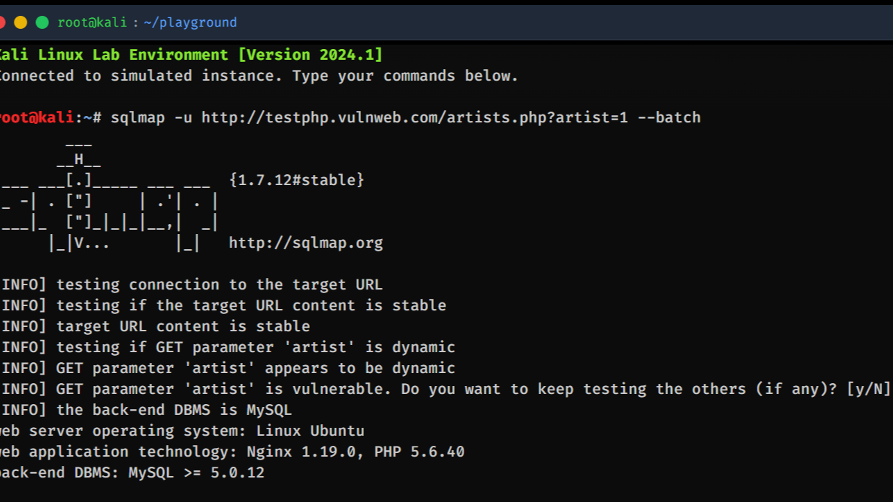

Quem já tentou ensinar ou aprender cibersegurança sabe perfeitamente: o abismo entre a teoria e a prática costuma ser desanimador. Entregar uma apostila de texto para um estudante e pedir que ele configure uma máquina virtual com Kali Linux, ajuste interfaces de rede em modo bridge e lide com erros de virtualização frequentemente gera mais frustração do que aprendizado real nas primeiras semanas de aula.

Observando essa barreira no cotidiano ao atender demandas de alunos na tutoria e aplicando o olhar do design instrucional com a engenharia de software, decidi que era hora de construir uma ponte mais acessível e elegante.

Muito se fala em inovação no ensino, mas frequentemente a inovação mais transformadora reside na **remoção de atrito**. A ideia por trás do **Kali Linux Labs Beginner** nasceu dessa premissa direta: transformar a introdução à segurança defensiva e ofensiva em uma experiência imersiva de terminal que dispense qualquer instalação local ou configuração de hardware complexa.

---

## O Ponto de Partida: Duas Décadas de Ensino a Distância

Meu primeiro contato prático com a educação a distância ocorreu lá atrás, em 2004. Naquela época, o modelo gravitava quase exclusivamente em torno de materiais textuais estáticos, apostilas impressas e PDFs digitalizados. 

Ao longo dos últimos vinte anos, uma infinidade de plataformas, LMSs e ferramentas foram criadas. As videoaulas foram, sem dúvida, um salto expressivo — primeiro distribuídas em mídias físicas como DVDs e, em seguida, massificadas por streaming sob demanda. Contudo, apesar do avanço audiovisual, a experiência de **interação e experimentação ativa** enquanto o aluno estuda ainda permanece restrita. 

Na prática, a ampla maioria dos ecossistemas de ensino ainda entrega ao estudante uma trilha passiva: assistir a um vídeo, ler um arquivo PDF e responder a um questionário de múltipla escolha.

> *Um dos questionamentos que sempre me acompanhou é: com todo o repertório de tecnologias modernas disponíveis, não passou da hora de superarmos os PDFs estáticos e as barras de progresso cosméticas para criar experiências verdadeiramente imersivas?*

Foi exatamente nesse contexto que concebi o laboratório virtual: uma plataforma acessada diretamente via navegador web, de implantação imediata, custo zero de servidores e com foco em quem está dando os primeiríssimos passos.

---

## A Ideia e a Proposta: Errar sem Medo

A grande dor identificada é comum a um perfil cada vez mais presente no ensino superior: alunos em plena **transição de carreira** para a área de Tecnologia da Informação. Muitos nunca utilizaram uma distribuição Linux, não conhecem a linha de comando e utilizam computadores modestos, onde alocar 4 GB de memória RAM para uma máquina virtual no VirtualBox simplesmente inviabiliza o computador de estudo.

A premissa pedagógica foi clara: **e se o laboratório fosse apenas uma aba no navegador?**

Eu queria proporcionar um ambiente onde o aluno pudesse testar comandos de reconhecimento de rede, análise de vulnerabilidades ou ataques controlados sem receio de quebrar o próprio sistema operacional, sem risco de corromper arquivos locais e sem expor a infraestrutura da instituição a tráfegos indevidos. Um espaço seguro para praticar, errar, entender a saída do terminal e consolidar os conceitos.

---

## Arquitetura Zero-Build: Simplicidade no Cliente

Para que a solução pudesse ser adotada por qualquer instituição, professor ou entusiasta com a mesma facilidade, a arquitetura técnica precisava ser cirúrgica: **nada de orquestração de containers Docker pesados no backend, servidores dedicados caros ou filas assíncronas complexas**.

O projeto foi concebido como uma **Single Page Application (SPA)** rodando 100% no lado do cliente:

1. **Interface e Estética de Terminal**: Estruturada com HTML5 semântico e Tailwind CSS, reproduzindo a atmosfera clássica de consoles de segurança.
2. **Emulação de Terminal de Alta Fidelidade**: Utilização da biblioteca **Xterm.js** para capturar inputs, renderizar cores ANSI, gerenciar buffers e entregar a sensação autêntica de digitação em linha de comando.
3. **Filosofia Zero-Build**: Não há necessidade de processos de compilação morosos. Toda a lógica de interpretação de comandos, gerenciamento do sistema de arquivos virtual e validação de missões roda no JavaScript do próprio navegador.

Basta clonar o repositório, subir um servidor estático simples (ou hospedar em serviços como GitHub Pages ou Vercel) e o laboratório está operacional para centenas de estudantes simultaneamente, com escalabilidade infinita e custo operacional zero.

---

## A Engine VirtualOS e o Ecossistema Simulado

O coração do projeto é o módulo **VirtualOS**, uma engine que interpreta as entradas do aluno, mantém o estado de navegação e reproduz com fidelidade o comportamento e as saídas das ferramentas consagradas de segurança do Kali Linux.

As ferramentas foram organizadas para acompanhar as etapas reais de um teste de intrusão (*pentest*):

### 1. Reconhecimento de Rede e OSINT
- **Nmap**: O consagrado scanner de rede. O laboratório simula varreduras de portas abertas, detecção de serviços, versões de software e identificação do sistema operacional do alvo.
- **Naabu**: Scanner de portas veloz e moderno, demonstrando análises rápidas para descoberta de superfícies de ataque.
- **Dnsx**: Utilitário DNS para resolução de nomes e enumeração ágil de subdomínios expostos.
- **Maltego**: Ferramenta de inteligência de fontes abertas (OSINT), simulando verificações de versão e contextualizando a inicialização do ambiente de investigação.

### 2. Análise de Vulnerabilidades Web
- **Nikto**: Scanner clássico para servidores HTTP, simulando checagens de arquivos perigosos, configurações inseguras e desvios de padrões web.
- **Nuclei**: Scanner veloz baseado em templates, simulando a detecção automatizada de tecnologias e verificação de CVEs críticos.
- **SQLMap**: Referência absoluta em injeção de SQL. A simulação conduz o estudante desde a verificação inicial de um parâmetro dinâmico vulnerável até a enumeração de bancos de dados e extração estruturada de tabelas.
- **Burp Suite**: Essencial para proxy e auditoria web, simulando conceitualmente a inicialização do listener de interceptação de tráfego.

### 3. Exploração e Ataques de Dicionário
- **Metasploit Framework**: O ambiente entrega uma simulação interativa do `msfconsole`, permitindo buscar módulos de vulnerabilidades (`search`), carregar exploits (`use`), configurar payloads e alvos (`set RHOSTS`) e acionar a exploração controlada (`exploit`).
- **Hydra**: Focado em ataques de força bruta online, simulando ataques de dicionário contra serviços SSH e FTP com retorno didático dos acertos e erros de credenciais.

### 4. Navegação do Sistema de Arquivos Virtual (Playground)
No modo livre, o motor compreende comandos nativos fundamentais do Linux — como `ls`, `cd`, `pwd`, `cat`, `whoami`, `mkdir` e `clear`. Isso permite que o estudante navegue por diretórios, leia anotações, explore arquivos de configuração e descubra *flags* ocultas em dinâmicas de estilo *Capture The Flag* (CTF).

---

## O Papel da Inteligência Artificial no Desenvolvimento

Criar do zero um interpretador no navegador capaz de emular comandos, validar argumentos por meio de expressões regulares complexas e manter o estado pedagógico das missões sem um backend tradicional foi um desafio instigante de engenharia.

Nesse processo, o uso de IDEs modernas potencializadas por **Inteligência Artificial** funcionou como um acelerador decisivo:

- **O Engenheiro como Arquiteto de Software**: Em vez de despender horas escrevendo parsers manuais repetitivos, meu papel principal foi arquitetar os fluxos pedagógicos, os objetivos de cada missão e os contratos entre os módulos ES6.
- **Construção e Refinamento de Regex**: A IA auxiliou na elaboração precisa de expressões regulares para capturar variações de comandos e parâmetros digitados pelos alunos (tolerando flags em diferentes ordens ou espaçamentos).
- **Aceleração da Camada Lógica**: O co-piloto de IA absorveu o trabalho braçal de scaffolding de dados e respostas simuladas, mantendo o foco do desenvolvimento no que realmente importava: **a experiência do usuário e o rigor instrucional**.

O resultado é um hub educacional coeso: com missões guiadas passo a passo, Wiki integrada de comandos e atalhos, leitor de documentação e compatibilidade com materiais multimídia.

---

## Reflexão: O Conhecimento Passivo versus a Experimentação Prática

A tecnologia por si só não resolve os problemas do ensino, mas a tecnologia bem desenhada elimina as barreiras invisíveis que distanciam as pessoas do conhecimento técnico.

> *O quanto do que chamamos de "aprendizado" é apenas consumo passivo de telas e o quanto é verdadeira experimentação prática, onde o indivíduo formula uma hipótese, executa um comando e interpreta o resultado?*

O futuro da educação tecnológica passa necessariamente pela criação de ferramentas que reduzam a fricção inicial e convidem o aluno a experimentar desde o primeiro minuto. Se conseguimos colocar um ambiente de terminal seguro e responsivo dentro de uma aba do navegador, tornamos a formação em tecnologia mais democrática, instigante e acessível para qualquer pessoa.

---

### Repositório e Código Aberto
O projeto está disponível para quem deseja explorar, testar em sala de aula ou contribuir com novos cenários e ferramentas:

👉 **Acesse o repositório:** [Kali Linux Labs Beginner no GitHub](https://github.com/vitorkrewer/kali-linux-labs-beginner)